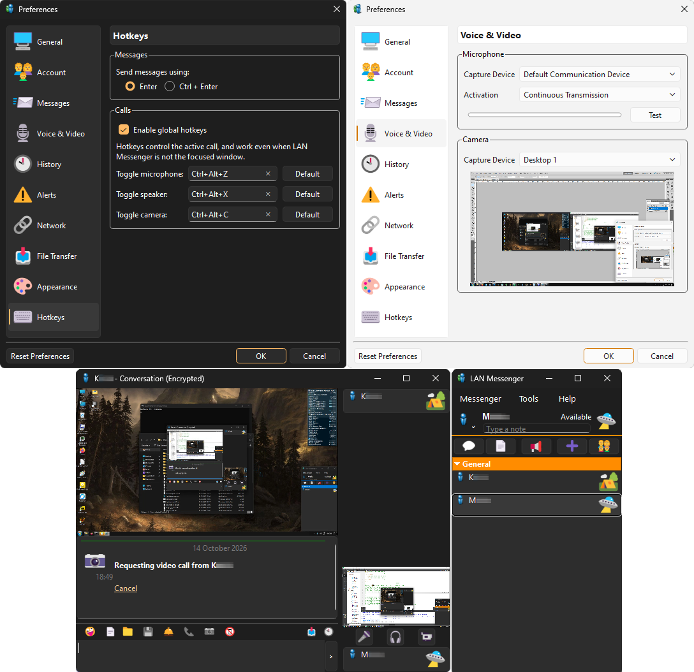

Notes
===========================
Project related todo list and known issues are written down in main cmakelists.

I would like to maintain compatibility between this and mainline versions, while adding more in the future. 

Tips & Tricks
============================
* Wrap UNC paths within quotes if they include spaces: "\\SambaShare\Folder\S p a c e.png"
* Shift enter always adds a newline regardless of enter/ctrl+enter setting.
* Writing --, __, == in chat will add a horizontal rule.
* Pasting image snippets and files into chatbox sends them over.
* You are not limited to smileys that the program presents you. You can use any unicode emoji.

Why LAN Messenger? (2026)
============================
* No accounts, no logins.
* Serverless. No need to keep a computer on, just to communicate.
* Complete privacy. Your data stays within your network.
* Lightweight. Stays out of your way.
* Internet independent. Feel the joy of asking a peer: "Is the internet working?"
* Nudging. Annoy your friends shamelessly!
* 1 on 1 Encrypted communications.
* Voice chat. (Opus 96kbps auto, encrypted)
* Video chat/desktop sharing (VP8 720p 30fps 2000kbps, encrypted)
* Multi platform (Eventually - mainline linux & mac versions are compatible.)

User interface
============================

How to compile LAN Messenger on Windows
============================
This project was compiled on Windows 11 with;

* Qt Creator 18.0.1   (C:/Qt/)
* Qt 6.12.0 MinGW 64 bit
* Win64OpenSSL-3.6.0  (C:/Qt/Tools/OpenSSL-Win64)
	* For compiled binaries: slproweb.com/products/Win32OpenSSL.html
* Libopus (C:/Qt/Tools/opus-1.6)
	* Compile the project into (/build/release)
* Libvpx (C:\Qt\Tools\libvpx-1.7)
	* MSYS2 has prebuilt MinGW libvpx https://repo.msys2.org/mingw/mingw64/
	* find the latest .tar.zst and extract it

